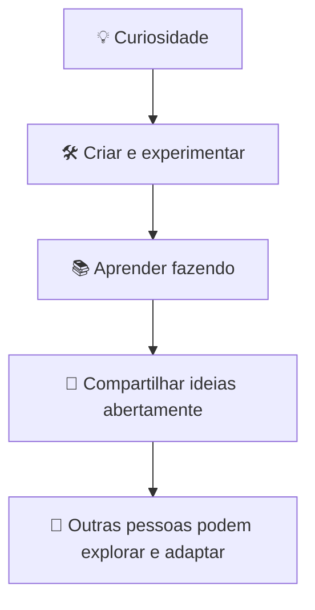

## Propósito

Bedatty Engineering é um espaço pessoal para criar e compartilhar coisas de forma aberta. Reúne atividades de homelab, projetos paralelos, experimentos e aprendizados durante a exploração de software e infraestrutura. A organização não é uma empresa nem uma organização de produto com roadmap ou calendário de releases: é um lugar para seguir a curiosidade, testar ideias e deixar contexto útil para outras pessoas.

## Para que serve

O workspace apoia o aprendizado prático e a experimentação. Parte do trabalho pode ganhar mais acabamento com o tempo; outras ideias permanecem pequenas ou intencionalmente simples. Utilidade e contexto claro importam mais do que polimento, e cada repositório tem seu próprio escopo e nível de maturidade.

## Como usar o workspace

Qualquer pessoa pode explorar o trabalho público, ler o contexto disponível e fazer fork ou adaptar padrões que façam sentido. Para tratar de algum problema, abra uma issue no repositório que contém o código ou a documentação relacionada, mantendo a conversa junto do contexto.

As expectativas de contribuição variam por repositório. Consulte o README e o rastreador de issues antes de propor mudanças; pull requests pequenos e focados são bem-vindos quando o projeto indicar que aceita contribuições. Este é um espaço pessoal mantido em um ritmo guiado pela curiosidade, sem compromisso de prazo para responder issues ou revisar contribuições. Avalie cada projeto antes de depender dele.

## Comunidade e manutenção

A organização é mantida por Lucas Bedatty. As orientações compartilhadas explicam como contribuir, onde pedir ajuda e como tratar questões de segurança. Cada repositório mantém suas próprias escolhas técnicas, maturidade, licença e expectativas de contribuição.
