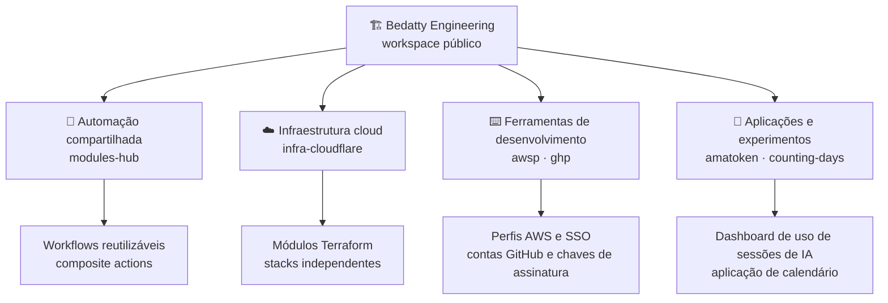
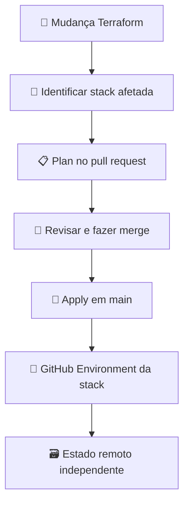

## Visão geral

Bedatty Engineering é um workspace público para infraestrutura pessoal, software, experimentos de homelab e aprendizado aberto. Os repositórios vão de automações reutilizáveis e ferramentas de cloud a utilitários de linha de comando e pequenas aplicações. Cada repositório tem seu próprio escopo e nível de maturidade; a organização é um espaço para construir e compartilhar padrões úteis, não um roadmap único de produto.

## Arquitetura do workspace

Os repositórios continuam úteis de forma independente, enquanto a automação compartilhada e os padrões de infraestrutura facilitam a manutenção de tarefas recorrentes.

## Automação compartilhada e infraestrutura cloud

O [`modules-hub`](https://github.com/Bedatty-Engineering/modules-hub) centraliza workflows e composite actions reutilizáveis do GitHub Actions. Outros repositórios podem consumi-los por referências fixadas em versões, mantendo validações e automações comuns em um lugar só e permitindo que cada consumidor escolha as verificações necessárias.

O [`infra-cloudflare`](https://github.com/Bedatty-Engineering/infra-cloudflare) gerencia bases de hospedagem, DNS e deploy com Terraform. Módulos reutilizáveis ficam separados das raízes das stacks. Cada stack controla seu backend e estado, limitando o impacto de mudanças. Pull requests executam plans para as stacks afetadas; pushes em `main` aplicam as mudanças por GitHub Environments específicos de cada stack.

## Ferramentas e aplicações

A organização também publica ferramentas focadas em fluxos recorrentes. O [`awsp`](https://github.com/Bedatty-Engineering/awsp) alterna perfis do AWS CLI, oferece login e logout via SSO e configura perfil e região no shell atual. O [`ghp`](https://github.com/Bedatty-Engineering/ghp) gerencia contas autenticadas do GitHub CLI e pode criar ou reutilizar chaves SSH Ed25519 para assinatura.

O [`amatoken`](https://github.com/Bedatty-Engineering/amatoken) é um dashboard Go auto-hospedado que lê dados locais de sessões do Claude Code e, quando disponíveis, do Codex, agrupando tokens e custos por sessão, projeto e modelo. O [`counting-days`](https://github.com/Bedatty-Engineering/counting-days) é um calendário independente que destaca o dia atual e o progresso do ano.

## Segurança e limites operacionais

As stacks de infraestrutura usam estados e GitHub Environments separados, e entradas sensíveis ficam fora do repositório. As ferramentas de linha de comando usam os fluxos de autenticação existentes da AWS e do GitHub, sem introduzir um serviço central de credenciais. Cada repositório documenta seus requisitos e expectativas de contribuição para que pequenos experimentos não precisem carregar uma estrutura de plataforma desnecessária.

## Resultados

A organização pública reúne automação reutilizável, um fluxo Terraform documentado para infraestrutura Cloudflare, utilitários práticos para AWS e GitHub e aplicações mantidas de forma independente. Os repositórios podem ser inspecionados e reutilizados; não há métricas agregadas públicas de uso ou adoção.

## Minha contribuição

Mantenho a organização e construo sua automação compartilhada, infraestrutura como código, ferramentas de desenvolvimento e experimentos pessoais de software, documentando como cada repositório pode ser usado e operado.
