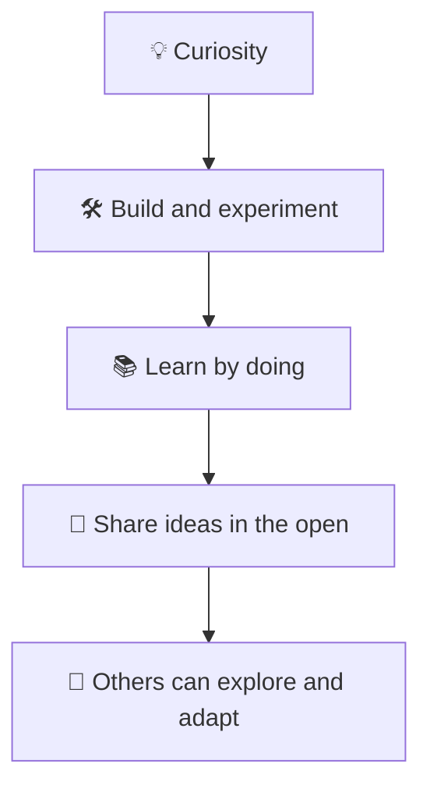

## Purpose

Bedatty Engineering is a personal space for building and sharing things in the open. It brings together homelab work, side projects, experiments, and lessons learned while exploring software and infrastructure. The organization is not a company or a product organization with a roadmap or release schedule; it is a place to follow curiosity, try ideas, and leave useful context for others.

## What the organization is for

The workspace supports hands-on learning and experimentation. Some work may become more polished over time, while other ideas remain small or intentionally rough. Usefulness and clear context matter more than polish, and each repository has its own scope and maturity.

## How to use the workspace

Anyone can browse the public work, read the context provided, and fork or adapt patterns that suit their needs. When something needs attention, open an issue in the repository that contains the relevant code or documentation so the discussion stays with its context.

Contribution expectations vary by repository. Check its README and issue tracker before proposing changes; focused pull requests are welcome where the project says contributions make sense. This is a personal workspace maintained at a curiosity-driven pace, with no service-level commitment for issues or reviews. Evaluate each project for your own needs before relying on it.

## Community and ownership

The organization is maintained by Lucas Bedatty. Shared community guidance explains how to contribute, where to ask for help, and how security concerns are handled. Individual repositories retain their own technical choices, maturity, licensing, and contribution expectations.
