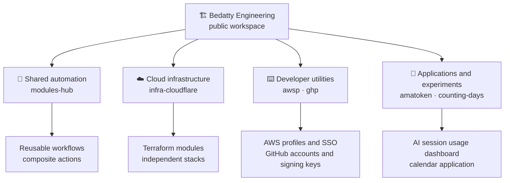
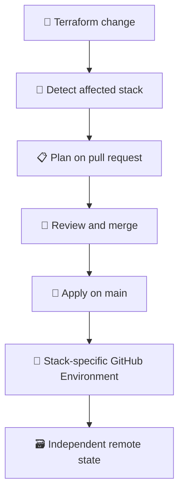

## Overview

Bedatty Engineering is a public workspace for personal infrastructure, software, homelab experiments, and learning in the open. Its repositories range from reusable automation and cloud tooling to command-line utilities and small applications. Each repository has its own scope and maturity; the organization is a place to build and share useful patterns, not a single product roadmap.

## Workspace architecture

The repositories remain independently useful while shared automation and infrastructure patterns make recurring work easier to maintain.

## Shared automation and cloud infrastructure

[`modules-hub`](https://github.com/Bedatty-Engineering/modules-hub) centralizes reusable GitHub Actions workflows and composite actions. Other repositories can consume them through version-pinned references, keeping common validation and automation in one place while allowing each caller to choose the checks it needs.

[`infra-cloudflare`](https://github.com/Bedatty-Engineering/infra-cloudflare) manages hosting, DNS, and deployment foundations with Terraform. Reusable modules are separated from stack roots. Each stack owns its backend and state, limiting the blast radius of changes. Pull requests run plans for affected stacks; pushes to `main` apply approved changes through stack-specific GitHub Environments.

## Developer tools and applications

The organization also publishes focused tools for recurring workflows. [`awsp`](https://github.com/Bedatty-Engineering/awsp) switches AWS CLI profiles, supports SSO login and logout, and exposes profile and region settings to the current shell. [`ghp`](https://github.com/Bedatty-Engineering/ghp) manages authenticated GitHub CLI accounts and can create or reuse Ed25519 SSH signing keys.

[`amatoken`](https://github.com/Bedatty-Engineering/amatoken) is a self-hosted Go dashboard that reads local Claude Code session data and Codex session data when available, then groups token usage and cost by session, project, and model. [`counting-days`](https://github.com/Bedatty-Engineering/counting-days) is a standalone calendar that highlights the current day and year progress.

## Security and operating boundaries

Infrastructure stacks use separate state and GitHub Environments, and sensitive inputs are kept out of the repository. The CLI tools use the existing AWS and GitHub authentication flows rather than introducing a central credential service. Individual repositories document their own requirements and contribution expectations, so a small experiment does not inherit unnecessary platform machinery.

## Results

The public organization provides reusable automation, a documented Terraform workflow for Cloudflare infrastructure, practical AWS and GitHub CLI utilities, and independently maintained applications. The repositories are available to inspect and reuse; no aggregate usage or adoption metrics are published.

## My role

I maintain the organization and build its shared automation, infrastructure code, developer tools, and personal software experiments, documenting how each repository can be used and operated.
