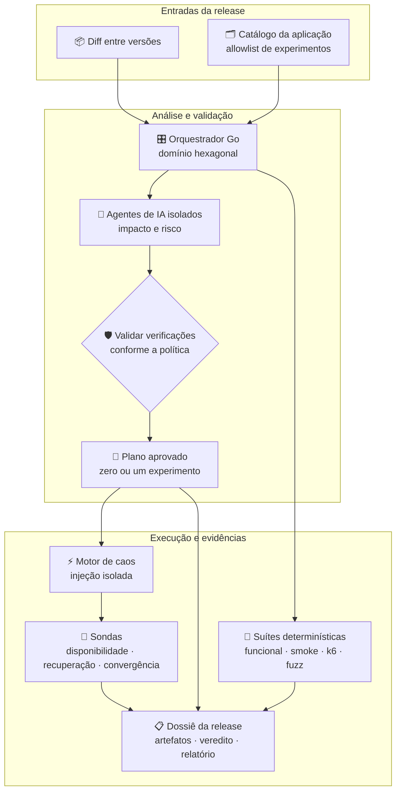
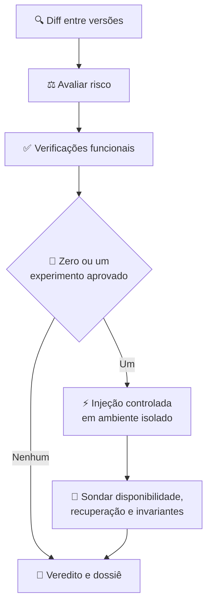

## Visão geral

Uma release financeira precisa de evidências melhores do que um deploy bem-sucedido ou uma resposta HTTP 200. Esta plataforma combina análise sensível à mudança com suítes repetíveis e registra um veredito acompanhado das evidências que o sustentam. Os dois modos de validação rodam na esteira de entrega, mantendo execuções, artefatos e vereditos independentes.

## Arquitetura e limites

O orquestrador em Go coordena o gate de release; ele não injeta falhas. Seu domínio hexagonal mantém a lógica de decisão independente dos sistemas externos por meio de ports & adapters, com adaptadores reais e simulados para integrações. Agentes de IA especializados rodam em ambientes isolados. A biblioteca de experimentos, o catálogo por aplicação e o histórico de releases são versionados como código em GitOps.

Os modos agêntico e não agêntico são superfícies de validação distintas, correlacionadas pela mesma release. Assim, um resultado agêntico não encobre uma falha determinística, nem o contrário.

## Fluxo de validação da release

Cada execução segue uma sequência definida. O risco altera quais verificações autorizadas são selecionadas, mas não muda o contrato de execução.

1. **Análise da mudança:** inspecionar o diff entre versões, identificar áreas impactadas e estimar o risco.
2. **Gate funcional:** verificar o comportamento esperado antes de qualquer injeção de falha.
3. **Seleção do cenário:** escolher no máximo um experimento aprovado, proporcional à severidade avaliada.
4. **Injeção controlada:** um motor de caos dedicado executa o experimento em ambiente isolado enquanto sondas observam o sistema.
5. **Veredito:** consolidar resultados dos testes, pontuação de resiliência, metadados e evidências legíveis sob a release.

## Dois modos de validação

### Análise agêntica

Agentes isolados analisam o diff, estimam o risco e propõem verificações focadas nos componentes impactados. Eles só podem selecionar experimentos aprovados para aquela aplicação. O orquestrador valida a saída antes que ela influencie o plano de execução, mantendo a flexibilidade da análise dentro de um gate de release controlado.

### Suítes determinísticas

Suítes criadas e revisadas por pessoas oferecem uma linha de base repetível. Elas incluem smoke tests e verificações funcionais, cenários de carga com k6, testes de entrada malformada e fuzzing, além de experimentos de caos definidos como código. A mesma suíte gera as mesmas verificações planejadas, servindo como referência estável para comparar execuções agênticas.

Cada modo tem execução, veredito e artefatos próprios. A release correlaciona as evidências sem fundi-las em um sinal único e opaco de aprovação ou reprovação.

## Controles de risco e execução de caos

O catálogo da aplicação funciona como uma allowlist: define quais experimentos podem ser executados contra cada aplicação e registra seus responsáveis. A avaliação de risco define a intensidade de um cenário elegível, de uma falha leve a uma interrupção mais severa. Uma execução pode rodar zero ou um experimento, nunca uma sequência sem limite escolhida por um agente.

Coordenação e injeção têm responsabilidades separadas. O orquestrador seleciona e valida o plano; um motor de caos dedicado executa a falha. Experimentos, catálogo e histórico são versionados no Git e passam por revisão com as mesmas convenções de ownership do código das aplicações. Ambientes isolados restringem onde a injeção de falhas é permitida.

## Sondas, veredito e trilha de auditoria

Resultados de caos só são interpretáveis quando o sistema é observado antes, durante e depois da injeção. As sondas acompanham o tipo de falha: verificações contínuas de disponibilidade, recuperação após o fim da falha e convergência de fluxos assíncronos. O gate distingue indisponibilidade tolerada de condições que nunca podem ocorrer, como perda da integridade funcional.

Cada release deixa um dossiê versionado com o plano validado, o script executado, os metadados do experimento e um relatório legível. Esse registro permite reconstruir qual versão foi testada, quais verificações rodaram, por que um experimento foi selecionado e como o sistema respondeu.

## Decisões e trade-offs de engenharia

O principal limite de projeto é equilibrar a análise adaptável com o determinismo que um gate de release exige. Execução isolada de agentes, experimentos em allowlist, validação de saída e o limite de um experimento restringem essa flexibilidade. Manter as execuções agênticas e não agênticas separadas preserva a atribuição quando uma superfície encontra uma regressão e a outra não.

A plataforma também trata observabilidade como parte do contrato do experimento: uma falha sem sondas de disponibilidade, recuperação e invariantes funcionais produz ruído, não evidência útil de resiliência. Configurações declarativas reduzem o atrito de entrada, enquanto suítes específicas por aplicação podem ampliar a cobertura sob as mesmas convenções de versionamento, nomenclatura e revisão.
