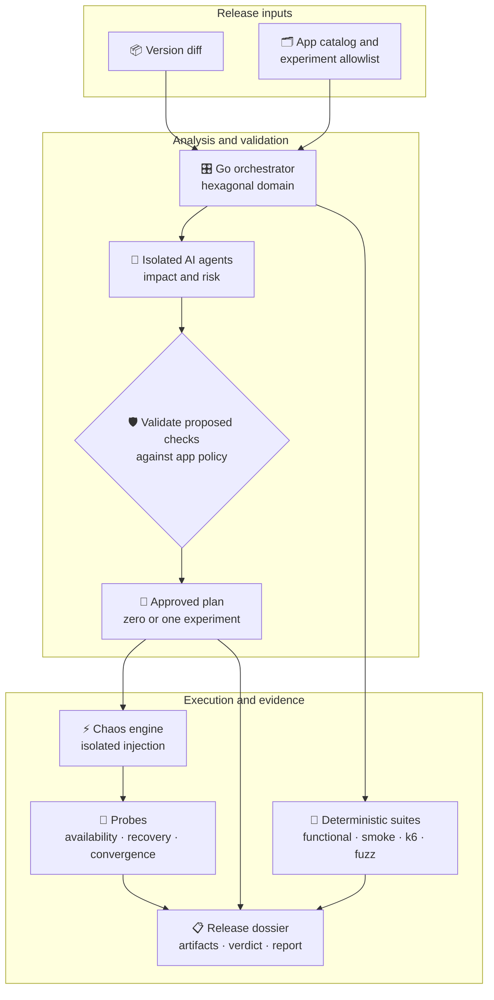
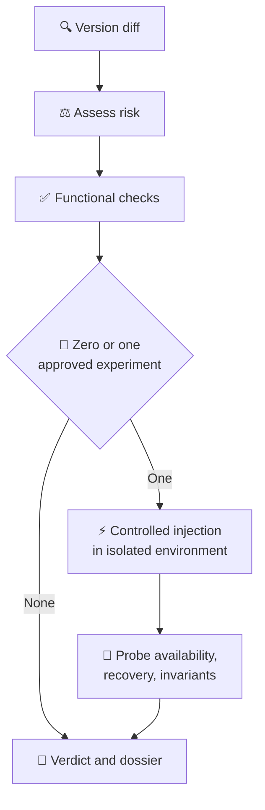

## Overview

A financial release needs stronger evidence than a successful deployment or an HTTP 200 response. This platform combines change-aware analysis with repeatable test suites, then records a release verdict with the evidence behind it. Both validation modes run in the delivery pipeline while keeping their executions, artifacts, and verdicts independent.

## Architecture and boundaries

The Go orchestrator coordinates the release gate; it does not inject failures. Its hexagonal domain keeps decision logic independent from external systems through ports and adapters, with real and simulated adapters for integrations. Specialized AI agents run in isolated environments. A versioned experiment library, application catalog, and release history are managed as code through GitOps.

The two modes are separate validation surfaces correlated by the same release. This keeps an agentic result from concealing a deterministic failure, or vice versa.

## Release validation flow

Each run follows a fixed sequence. Risk changes which authorized checks are selected; it does not change the execution contract.

1. **Change analysis:** inspect the version diff, identify affected areas, and estimate risk.
2. **Functional gate:** verify expected behavior before any failure is injected.
3. **Scenario selection:** choose at most one approved experiment, proportional to assessed severity.
4. **Controlled injection:** a dedicated chaos engine runs the experiment in an isolated environment while probes observe the system.
5. **Verdict:** consolidate test results, resilience score, metadata, and readable evidence under the release.

## Two validation modes

### Agentic analysis

Isolated agents analyze the diff, estimate risk, and propose focused checks for impacted components. They may select only from the experiments approved for that application. The orchestrator validates their output before it can influence the execution plan, so flexible analysis stays inside a bounded release gate.

### Deterministic suites

Human-authored and reviewed suites provide a repeatable baseline. They include smoke and functional checks, k6 load scenarios, malformed-input and fuzz testing, and chaos experiments defined as code. The same suite produces the same planned checks, making it a stable reference for comparing agentic runs.

Each mode has its own run, verdict, and artifacts. The release correlates the evidence without merging the results into a single opaque pass/fail signal.

## Risk controls and chaos execution

The application catalog is an allowlist: it defines which experiments can run against each application and records ownership. The risk assessment determines the intensity of an eligible scenario, from a low-impact failure to a more severe disruption. A run can execute zero or one experiment, never an unbounded sequence selected by an agent.

Coordination and injection have separate responsibilities. The orchestrator selects and validates the plan; a dedicated chaos engine performs the fault. Experiments, catalog entries, and history are versioned in Git and reviewed with the same ownership conventions as application code. Isolated environments restrict where failure injection is permitted.

## Probes, verdict, and audit trail

Chaos results are meaningful only when the system is observed before, during, and after injection. Probes match the failure mode: continuous availability checks, recovery checks after the fault ends, and convergence checks for asynchronous flows. The gate distinguishes tolerated unavailability from conditions that must never occur, such as loss of functional integrity.

Every release leaves a versioned dossier containing the validated plan, executed script, experiment metadata, and a readable report. That record makes it possible to reconstruct which version was tested, which checks ran, why an experiment was selected, and how the system responded.

## Engineering trade-offs

The central design constraint is balancing adaptive analysis with the determinism required by a release gate. Isolated agent execution, allowlisted experiments, output validation, and a one-experiment limit constrain that flexibility. Keeping agentic and non-agentic runs distinct preserves attribution when one surface finds a regression and the other does not.

The platform also treats observability as part of the experiment contract: a fault without probes for availability, recovery, and functional invariants produces noise rather than useful resilience evidence. Declarative defaults reduce onboarding effort, while application-specific suites can add coverage under the same versioning, naming, and review conventions.
